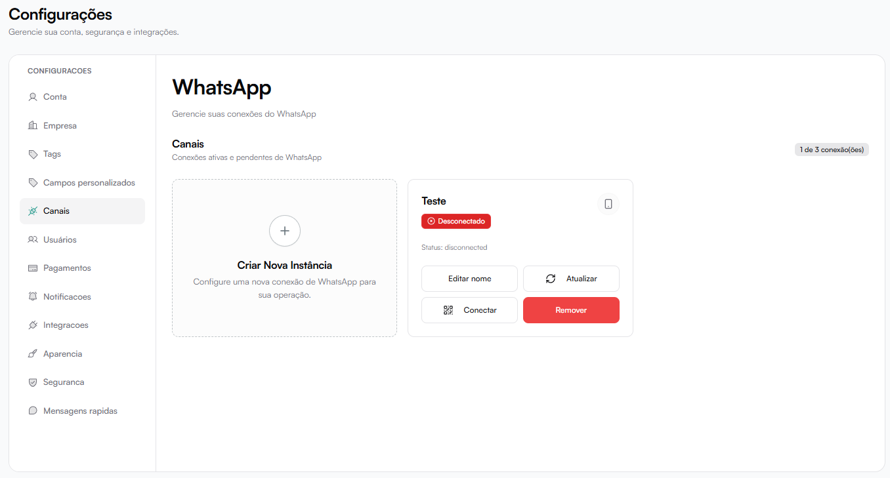
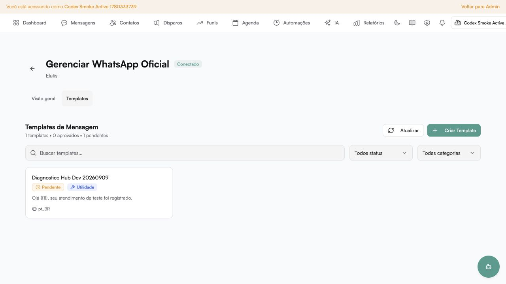

# Canais — WhatsApp

A seção **Canais** permite gerenciar as conexões de WhatsApp utilizadas no sistema.

Você pode:

- Criar novas instâncias
- Conectar via QR Code
- Conectar via API oficial (Meta, configuração manual ou 360dialog)
- Atualizar status
- Editar nome da instância
- Ativar chamadas nas linhas compatíveis
- Remover conexões
- Monitorar limite de conexões

Localização:  
**Configurações → Canais**

---

# Visão Geral da Tela

Na tela principal são exibidas:

- Lista de instâncias criadas
- Status de conexão
- Ações rápidas (Conectar, Atualizar, Editar nome, Remover)
- Contador de conexões utilizadas (ex: 2 de 3 conexões)

## Criar Nova Conexão

Para adicionar um novo canal:

1. Clique em **Criar Nova Instância**
2. Escolha o método de conexão

Você poderá escolher entre:

- UAZAPI (QR Code)
- WhatsApp Meta API (API Oficial)

# Métodos de Conexão

### 1. UAZAPI (QR Code)

Conexão rápida via espelhamento do WhatsApp Web.

#### Vantagens
- Setup instantâneo
- Não precisa de verificação empresarial
- Processo simples

#### Atenção
- Pode sofrer bloqueios
- Não é a API oficial
- Depende do WhatsApp Web ativo

#### Processo:
1. Definir nome da instância
2. Criar instância
3. Escanear o QR Code
4. Aguardar conexão

O sistema cria automaticamente um ID interno para a instância.

### 2. WhatsApp Meta API (API Oficial)

Conexão oficial via WhatsApp Business Cloud API.

#### Vantagens
- 100% compliant
- Sem risco de ban
- Conexão oficial com Meta

#### Requisitos:
- Conta no Facebook/Meta Business
- WhatsApp Business Account (WABA)
- Número de telefone verificado

#### Processo:
1. Selecione o card **WhatsApp API Oficial**.
2. Escolha como conectar:
   - **Cadastro com a Meta**: você entra com a sua conta do Facebook e escolhe o número. Indicado para números novos na API Oficial.
   - **Configurar manualmente**: você informa os IDs e o token de um número que já está na API Oficial.
   - **Conectar com 360dialog**: você cola a chave de API do número gerada no painel da 360dialog (veja abaixo).
3. Siga os passos da opção escolhida. Quando uma opção não está disponível para a sua conta, o motivo aparece logo abaixo dela.

### 3. API Oficial pela 360dialog

Para números do WhatsApp que estão na 360dialog. O canal funciona como a API Oficial: valem a janela de 24 horas, os modelos de mensagem e as confirmações de entrega e leitura.

#### Antes de começar
- Gere a chave de API do número no painel da 360dialog (Hub). Cada número tem a sua chave.
- Se o número já funciona em outro sistema, use a mesma chave que esse sistema usa. Gerar uma chave nova no Hub desliga a chave anterior, e o outro sistema para de funcionar.

#### Processo:
1. Selecione **WhatsApp API Oficial** e depois **Conectar com 360dialog**.
2. Informe o nome do canal, a cor e cole a chave de API.
3. Clique em **Validar e conectar**.
4. Se o número já envia mensagens para outro sistema, escolha:
   - **Manter os dois recebendo**: o outro sistema continua funcionando enquanto você faz a troca. As respostas enviadas pelo outro sistema não aparecem no FalaMais.
   - **Usar só o FalaMais**: o outro sistema deixa de receber as mensagens deste número.

Para conectar vários números, repita o processo para cada um.

#### Depois de conectado
- O card mostra **via 360dialog** e o número conectado.
- O perfil público do número (foto, descrição e site) é editado no painel da 360dialog.
- Se a chave deixar de valer, o card mostra **Atualizar chave**: cole a chave nova para reconectar.

## Canais por conector em instalações habilitadas

Em instalações que usam um conector de canais, o administrador define a conexão
utilizada pela empresa. A empresa continua gerenciando seus canais pela mesma tela.

### Escolher um canal já conectado

Ao iniciar a conexão, o sistema consulta os canais disponíveis para a empresa.
Se houver um canal conectado, selecione-o para adicioná-lo sem repetir o
assistente. Para conectar outro canal, escolha a opção de criar uma nova conexão.
Canais vinculados a outra empresa não ficam disponíveis para adoção.

Se um canal for conectado por outro caminho autorizado, ele também pode aparecer
na empresa quando o sistema receber a confirmação da conexão.

### Modo da credencial

O Super Admin encontra o seletor **Modo da key** nas configurações da plataforma:

- **Tenant:** padrão para novas configurações. Use uma conta dedicada à instalação;
  cada empresa recebe uma subconta própria, com limite de canais e recebimento
  separados.
- **Subconta:** use uma credencial exclusiva de uma empresa.

Ao salvar, o sistema confere se a credencial corresponde ao modo selecionado.
Em caso de divergência, a configuração anterior é preservada e o aviso informa
qual modo escolher. **Testar usage** identifica a conta e o tipo da credencial.

### Verificação do recebimento

Antes de iniciar uma conexão, o sistema verifica se consegue receber um evento
de teste. Se a confirmação estiver pendente, aguarde alguns segundos e tente
novamente. Se a entrega falhar, peça ao administrador para conferir a configuração
de recebimento e repita a tentativa após o ajuste.

## Cartão da Instância

Cada instância exibida na tela mostra:

- Nome da instância
- Status (Conectado / Desconectado / Connecting)
- Ícone do canal
- Ações disponíveis

## Ações Disponíveis

### Chamadas

Em contas habilitadas, as linhas UAZAPI mostram a seção **Chamadas**. Use
**Ativar** para informar o token Wavoip e obter o webhook ou **Configurar** para
trocar credenciais, gerar outro webhook e desativar a telefonia da linha.

O status **Pronta** aparece somente depois que o dispositivo confirma a conexão.
Veja o passo a passo em [Chamadas pelo WhatsApp](./chamadas-whatsapp.md).

### Editar nome
Permite alterar o nome exibido da instância.

### Atualizar
Atualiza o status da conexão.

Utilizado quando:
- Conexão caiu
- Após escanear QR
- Após configuração da API

### Conectar
Inicia o processo de conexão:

- QR Code → Exibe QR para escanear
- API → Redireciona para autenticação Meta

### Remover Instância

Permite excluir uma conexão ativa.

Antes de remover, o sistema exibe:

- Quantidade de prompts vinculados
- Conversas abertas
- Follow-ups ativos
- Agendamentos
- Integrações relacionadas

#### Migração ao Remover

Antes da remoção definitiva, é necessário:

- Selecionar uma instância de destino

Todos os dados vinculados serão migrados para o canal selecionado:

- Conversas
- Prompts
- Follow-ups
- Agendamentos

Após confirmar, a instância será removida.

## Limite de Conexões

No topo da tela é exibido:

Exemplo:
`2 de 3 conexões`

Isso indica o número de instâncias utilizadas em relação ao limite contratado.

## Status da Instância

Os possíveis estados são:

- Conectado
- Desconectado
- Connecting

O status impacta diretamente no recebimento e envio de mensagens.

### Telefone de canais conectados pelo conector

A sincronização consulta os detalhes do canal para exibir o telefone completo,
incluindo o código do país. Se um canal conectado estiver sem número, execute
a sincronização novamente. O número depende das informações disponibilizadas
pelo provedor; a sincronização não altera o telefone conectado.

### Templates nos canais conectados pelo Hub

Nas instalações com o conector habilitado, abra o canal oficial e acesse a aba **Templates**. A criação e a sincronização usam a conta vinculada ao próprio canal.

1. Crie o template com nome, idioma, categoria e conteúdo.
2. Preencha os exemplos das variáveis quando solicitados e salve.
3. Use a sincronização para atualizar o catálogo e acompanhar a análise do WhatsApp.
4. Aguarde o status **Aprovado** antes de enviar o template.

Um template **Pendente** foi recebido pelo provedor, mas ainda não está liberado para envio. A sincronização preserva o conteúdo e o status recebido; ela não aprova o template.

O envio pelo conector aceita variáveis de texto no corpo. Cabeçalhos de mídia e parâmetros de botões não são suportados nesse envio. O carregamento de amostras de mídia para criar templates também não está disponível pelo conector. Quando um formato não é suportado, o sistema informa a limitação.

Os envios de templates ficam registrados no histórico da conversa. Se houver recusa do provedor, confira o erro apresentado antes de tentar novamente. O registro no histórico, por si só, não confirma que a mensagem foi entregue: acompanhe o status do envio.

Nos detalhes do canal, informações de qualidade e limites aparecem quando fornecidas pelo conector. A ausência desses dados não significa que o canal esteja com problemas.
